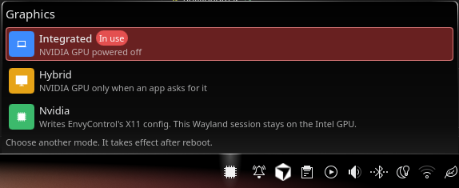

# EnvyControl panel applet

A KDE Plasma 6 panel applet for CachyOS that shows and switches the [EnvyControl](https://github.com/bayasdev/envycontrol) graphics mode.

It is meant for a laptop with Intel graphics and an NVIDIA GPU. The panel icon opens a popup with three modes. The mode already in use is marked in light red. Switching asks for your password, writes EnvyControl’s configuration, rebuilds the Limine boot entries, and takes effect only after a reboot.

| Mode | What it does |
| --- | --- |
| Integrated | Powers the NVIDIA GPU off and uses the Intel GPU. |
| Hybrid | Keeps the Intel GPU for the display and turns the NVIDIA GPU on when an app asks for it. |
| Nvidia | Writes EnvyControl’s X11 configuration for the NVIDIA GPU. |



On a Wayland session that uses greetd, Nvidia mode does not move the display onto the NVIDIA GPU. Integrated and Hybrid are the modes that change which GPU this machine uses after reboot.

## Requirements

- KDE Plasma 6
- CachyOS with the Limine bootloader (`limine-mkinitcpio`)
- `pkexec` and a polkit password prompt (KDE’s polkit agent)
- EnvyControl (`envycontrol` on `PATH`)

EnvyControl is an AUR package. If it is missing, the applet can install it with `paru` and `ksshaskpass`.

## Install the applet

From this directory:

```sh
./install.sh
```

That installs the package into `~/.local/share/plasma/plasmoids/`. If it is already installed, the script upgrades it.

Then right-click the panel, choose **Add Widgets**, and add **EnvyControl**.

After an upgrade, restart Plasma so the running panel loads the new copy:

```sh
systemctl --user restart plasma-plasmashell.service
```

To remove it:

```sh
kpackagetool6 --type Plasma/Applet --remove org.personal.envycontrol
```

## Usage

1. Click the GPU icon on the panel.
2. The row marked **In use** is the mode EnvyControl reports.
3. Click another mode, then **Switch to …**.
4. Confirm the dialog. The change applies after reboot.
5. Enter your password when polkit asks. The popup shows the switch log while EnvyControl and Limine run.
6. Reboot. The new mode is not active until then.

Choosing the mode that is already in use does nothing. Cancel closes the confirm dialog without changing anything. Dismissing the password prompt leaves the mode unchanged and shows **Authentication cancelled.**

A failed switch shows **Switch failed.** Open **Show details** for the command output.

### If EnvyControl is not installed

The popup shows **Install EnvyControl** instead of a current mode.

- **Install EnvyControl** installs the package and then reports that it is installed.
- Clicking a mode installs the package, then opens the reboot confirm if that mode is not the one EnvyControl reports after install.

The install command is:

```sh
SUDO_ASKPASS=/usr/bin/ksshaskpass /usr/bin/paru -S --noconfirm --needed --sudoflags --askpass envycontrol
```

`paru` is not run as root. The password prompt is only for the package install’s own `sudo`. If `paru` itself is missing, the applet tells you to install `paru` first.

## What a switch runs

The applet only switches among `integrated`, `hybrid`, and `nvidia`. It does not expose Coolbits, RTD3, Force Composition, or Reset.

The switch command is:

```sh
pkexec /bin/sh -c "umask 022; : > /tmp/envycontrol-applet.log; /usr/bin/script -q -e -f -c 'PYTHONUNBUFFERED=1 /usr/bin/envycontrol --switch MODE --verbose && /usr/bin/limine-mkinitcpio' /tmp/envycontrol-applet.log"
```

`limine-mkinitcpio` is required because CachyOS’s `mkinitcpio -P` does not update Limine boot entries. EnvyControl still runs `mkinitcpio -P` itself; the applet runs Limine afterward.

The live log is `/tmp/envycontrol-applet.log`.

## Tested on

- Operating System: CachyOS Linux
- KDE Plasma Version: 6.7.5
- KDE Frameworks Version: 6.30.0
- Qt Version: 6.12.0
- Kernel Version: 7.2.9-1-cachyos (64-bit)
- Graphics Platform: Wayland
- Processors: 12 × Intel® Core™ i7-9750H CPU @ 2.60GHz
- Memory: 16 GiB of RAM (15.4 GiB usable)
- Graphics Processor: Mesa Intel® UHD Graphics 630
- Manufacturer: Razer
- Product Name: Blade 15 Mid 2019-Base
- System Version: 3.04

## License

GPL-2.0-or-later
